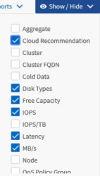

= Active IQ Unified Manager でレポートの列をカスタマイズする
:allow-uri-read: 
:icons: font
:imagesdir: ../media/

[role="lead"]
「表示/非表示」を使用して、レポートで使用する列を選択してください。インベントリページの列をドラッグして並べ替えてください。

.手順
. 「表示／非表示」をクリックすると、列を追加または削除できます。
+

. インベントリ ページで、列をドラッグしてレポートで必要な順序に並べ替えます。
. ビューに名前を付けて変更を保存します。

