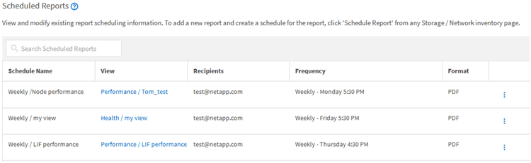

= Active IQ Unified Manager でスケジュールされたレポートを削除する
:allow-uri-read: 
:icons: font
:imagesdir: ../media/

[role="lead"]
スケジュールを設定したレポートは、[レポート スケジュール]ページで削除できます。

.開始する前に
* アプリケーション管理者またはストレージ管理者のロールが必要です。

.手順
. 左側のナビゲーションペインで、*ストレージ管理* ＞ *レポートスケジュール* をクリックします。
+

+
[NOTE]
====
適切な権限があれば、システム内のすべてのレポートとそのスケジュールを削除できます。

====
. 削除するスケジュールのその他アイコンimage:../media/more_icon.gif[""]をクリックします。
. *削除*をクリックします。
. 操作を確定します。
+
スケジュール済みレポートがリストから削除され、設定されたスケジュールで生成および配布されなくなります。

+
[NOTE]
====
インベントリ ページからカスタム ビューを削除すると、そのビューを使用するカスタムExcelファイルまたはスケジュール済みレポートも削除されます。

====

