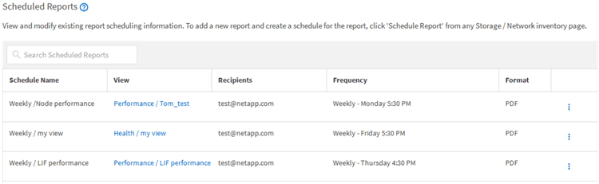

= Active IQ Unified Manager でスケジュールされたレポートを編集する
:allow-uri-read: 
:icons: font
:imagesdir: ../media/

[role="lead"]
スケジュールを設定したレポートは、[レポート スケジュール]ページで編集できます。

.開始する前に
* アプリケーション管理者またはストレージ管理者のロールが必要です。

.手順
. 左側のナビゲーションペインで、*ストレージ管理* ＞ *レポートスケジュール* をクリックします。
+

+
[NOTE]
====
適切な権限があれば、システム内のすべてのレポートとそのスケジュールを変更できます。

====
. 変更するスケジュールのその他アイコンimage:../media/more_icon.gif[""]をクリックします。
. *編集*をクリックします。
. レポートスケジュールの*Schedule Name*、*Recipient*リスト、*Frequency*、および*Format*を変更できます。
. 完了したら、チェック マークをクリックして変更を保存します。

