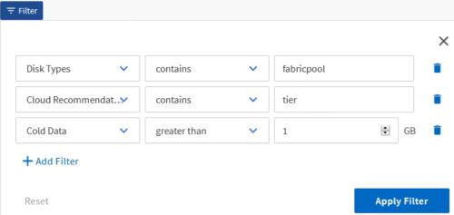

= Active IQ Unified Manager でデータをフィルタリングする
:allow-uri-read: 
:icons: font
:imagesdir: ../media/

[role="lead"]
要件を満たすレポートを作成するには、データをフィルタリングします。フィルタリングすることで関心のあるデータのみを表示できます。

.手順
. フィルターアイコンをクリックしてフィルターを追加し、表示したい結果を絞り込んでから、*フィルターを適用*をクリックしてください。
+

. ビューに名前を付けて変更を保存します。

