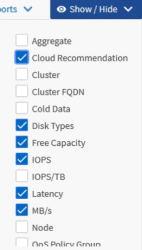
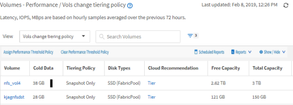
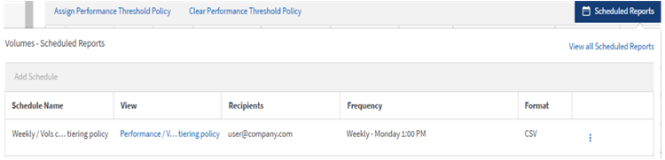
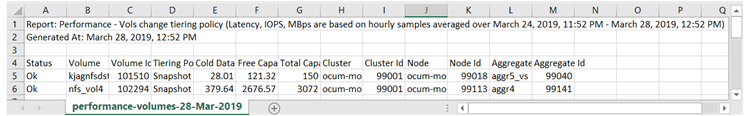
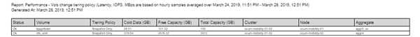

= Active IQ Unified Manager でのレポート作成の開始
:allow-uri-read: 
:icons: font
:imagesdir: ../media/

[role="lead"]
サンプルのカスタム レポートを作成して、各ビューの内容とレポートのスケジュール設定について学びます。このクイック スタートのレポートでは、アクセス頻度の低いコールド データが相当量あり、クラウド階層への移動を検討するボリュームを特定します。「パフォーマンス：全ボリューム」ビューを開き、フィルターと列を使用してビューをカスタマイズし、カスタマイズしたビューをレポートとして保存し、そのレポートを週に一度共有するようにスケジュールします。

.開始する前に
* アプリケーション管理者またはストレージ管理者のロールが必要です。
* FabricPoolアグリゲートを設定しておく必要があります。また、それらのアグリゲート上にボリュームが必要です。

以下の手順に従って、次の操作を実行します。

* デフォルト ビューを開く
* データをフィルタおよびソートで列をカスタマイズする
* ビューを保存する
* カスタム ビューに対して生成されるようにレポートをスケジュール設定する

.手順
. 左側のナビゲーションペインで、*ストレージ* ＞ *ボリューム* をクリックします。
. 「表示」メニューで、「パフォーマンス」＞「すべてのボリューム」を選択します。
. 「表示/非表示」をクリックして、「`Disk Types`」列がビューに表示されていることを確認してください。
+

+
列を追加または削除して、レポートに必要なフィールドを含むビューを作成します。

. 「`Disk Types`」列を「`Cloud Recommendation`」列の隣にドラッグします。
. フィルターアイコンをクリックして以下の3つのフィルターを追加し、*フィルターを適用*をクリックします。
+
** ディスクの種類にはFabricPoolが含まれます
** クラウドに関する推奨事項に階層が含まれる
** 10 GBを超えるコールドデータimage:../media/filter_cold_data_2.png["フィルターオプションからフィルターを適用する方法を示すUIスクリーンショット。"]

+
各フィルタは論理積で結合され、すべての条件を満たすボリュームだけが返されます。最大5個のフィルタを追加できます。

. [コールド データ]列の上部をクリックして結果をソートし、コールド データの量が最も多いボリュームがビューの先頭に表示されるようにします。
. ビューがカスタマイズされている場合、ビュー名はUnsaved Viewになります。ビューには、そのビューが表示する内容を反映する名前を付けます。たとえば、「`Vols change tiering policy`」などです。完了したら、チェックマークをクリックするか、*Enter*を押して、新しい名前でビューを保存します。
+

. レポートを*CSV*、*Excel*、または*PDF*ファイルとしてダウンロードして、スケジュール設定や共有を行う前に出力結果を確認してください。
+
Microsoft Excel（CSVまたはExcel）やAdobe Acrobat（PDF）などのインストールされているアプリケーションでファイルを開くか、またはファイルを保存します。

+
[NOTE]
====
ビューをExcelファイルとしてダウンロードすると、複雑なフィルタ、並べ替え、ピボット テーブル、グラフを使用してレポートをさらにカスタマイズできます。Excelでファイルを開いてから、高度な機能を使用してレポートをカスタマイズします。問題がなければ、Excelファイルをアップロードします。このファイルとそのカスタマイズ内容は、レポートの実行時にビューに適用されます。

====
+
Excel を使用したレポートのカスタマイズに関する詳細については、「Microsoft Excel レポートのサンプル」を参照してください。

. インベントリページの「スケジュール済みレポート」ボタンをクリックします。このリストには、対象オブジェクト（この場合はボリューム）に関連するすべてのスケジュール済みレポートが表示されます。
+

. *スケジュールを追加* をクリックして、レポートスケジュールページに新しい行を追加し、新しいレポートのスケジュール特性を定義します。
. レポートの名前を入力し、他のレポートフィールドへの入力を完了したら、行の最後にあるチェックマーク（image:../media/blue_check.gif[""]）をクリックします。
+
テスト レポートがすぐに送信されます。以降、指定した頻度でレポートが生成され、リスト内の受信者にEメールで送信されます。

+
CSV形式のサンプル レポートを次に示します。

+

+
PDF形式のサンプル レポートを次に示します。

+

レポートに示された結果に基づいて、ONTAP System ManagerまたはONTAP CLIを使用して、特定のボリュームの階層化ポリシーを「`auto`」または「`all`」に変更し、より多くのコールドデータをクラウド階層にオフロードすることをお勧めします。
