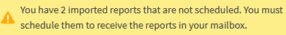
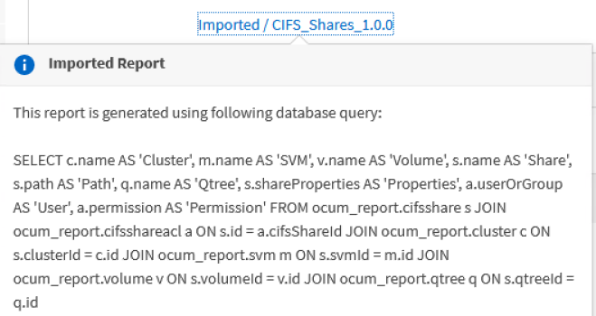

= Active IQ Unified Manager でインポートされた .rptdesign レポートをスケジュールする
:allow-uri-read: 
:icons: font
:imagesdir: ../media/

[role="lead"]
以前のリリースのUnified Managerで作成およびインポートした既存のレポートをスケジュールできます。

インポートしたレポートをスケジュール設定する場合の要件は次の通りです。

* 以前のUnified Managerリリースで設計し、インポートした.rptdesignファイル レポート
* Unified Manager 9.6 GA以降にアップグレードする場合に該当

Unified Manager 9.6 GA以降にアップグレードすると、「レポートスケジュール」ページにインポートされたレポートが表示されます。これらのレポートのスケジュールを編集して、受信者のEメール アドレス、頻度、形式（PDFまたはCSV）を指定できます。これらの編集をしていないレポートは、Unified Manager UIで編集または表示できません。

.手順
. [レポート スケジュール]ページを開きます。インポートしたレポートがある場合、次のようなメッセージが表示されます。
+

. 「View」名をクリックすると、レポート生成に使用されているSQLクエリが表示されます。
+

. その他アイコン  をクリックし、「編集」をクリックして、レポートのスケジュール詳細を定義し、レポートを保存します。
+
[NOTE]
====
不要なレポートは、その他アイコン  から削除することもできます。

====

