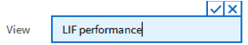
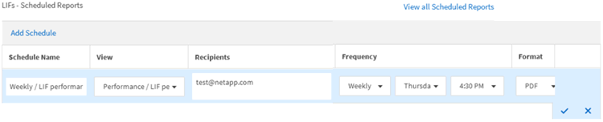

= Active IQ Unified Manager でレポートをスケジュールする
:allow-uri-read: 
:icons: font
:imagesdir: ../media/

[role="lead"]
スケジュールを設定して定期的に生成および配布するビューまたはExcelファイルを決定したら、レポートのスケジュールを設定できます。

.開始する前に
* アプリケーション管理者またはストレージ管理者のロールが必要です。
* レポートエンジンがUnified Managerサーバーから受信者リストにレポートをメール添付ファイルとして送信できるように、*一般* > *通知* ページでSMTPサーバーの設定を構成しておく必要があります。
* 生成されたEメールによる添付ファイルの送信を許可するよう、Eメール サーバを設定する必要があります。

次の手順を実行して、ビューに対して生成するレポートをテストし、スケジュール設定します。使用するビューを選択またはカスタマイズします。この手順ではネットワーク インターフェイスのパフォーマンスを表示するネットワーク ビューを使用しますが、任意のビューを使用できます。

.手順
. ビューを開きます。この例では、LIFのパフォーマンスを表示するデフォルトのネットワークビューを使用します。左側のナビゲーションペインで、*ネットワーク > ネットワークインターフェイス*をクリックします。
. Unified Managerに搭載されている機能を使用して、必要に応じてビューをカスタマイズします。
. ビューをカスタマイズしたら、*ビュー*フィールドに一意の名前を入力し、チェックマークをクリックして保存します。
+

. Microsoft® Excelの高度な機能を使用して、レポートをカスタマイズできます。詳細については、link:task_use_excel_to_customize_your_report.html["Excelを使用したレポートのカスタマイズ"]を参照してください。
. レポートをスケジュール設定または共有する前に内容を確認するには、次の手順を実行します。
+
[cols="2*"]
|===
| オプション | 説明 

 a| 
*Excelを使用してレポートをカスタマイズした場合*
 a| 
ダウンロードした既存のExcelファイルを表示します。

 a| 
*レポートのカスタマイズにExcelを使用しなかった場合*
 a| 
レポートを*CSV*、*PDF*、または*XLSX*ファイルとしてダウンロードしてください。

|===
+
Microsoft Excel（CSV / XSLX）やAdobe Acrobat（PDF）などのインストールされているアプリケーションでファイルを開きます。

. レポートの内容にご満足いただけましたら、*定期レポート*をクリックしてください。
. レポートスケジュールのページで、*スケジュールを追加*をクリックします。
. デフォルトの名前（ビュー名と頻度の組み合わせ）を受け入れるか、*スケジュール名*をカスタマイズしてください。
. スケジュールされたレポートを初めてテストするには、*受信者*として自分自身のみを追加してください。内容に問題がなければ、レポートの受信者全員のメールアドレスを追加してください。
. レポートの生成頻度と受信者への送信頻度を指定してください。*毎日*、*毎週*、*毎月*のいずれかを選択できます。
. フォーマットは、*PDF*、*CSV*、または*XSLX*から選択してください。
+
[NOTE]
====
Excelを使用してコンテンツをカスタマイズしたレポートの場合は、必ず*XSLX*を選択してください。

====
. レポートスケジュールを保存するには、チェックマーク（）をクリックします。
+

+
テスト レポートがすぐに送信されます。以降、スケジュール設定した頻度でレポートが生成され、リスト内の受信者にEメールで送信されます。

