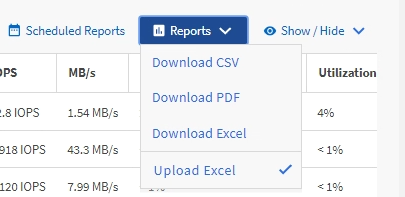

= Active IQ Unified Manager でExcelを使用してレポートをカスタマイズする
:allow-uri-read: 
:icons: font
:imagesdir: ../media/

[role="lead"]
保存したビューをExcelワークブック形式（.xlsx）でダウンロードできます。Excelファイルを開くと、Excelの高度な機能を使用してレポートをカスタマイズできます。

.開始する前に
アップロードできるのは拡張子が.xlsxのExcelワークブック ファイルのみです。

たとえば、次に示すExcelの高度な機能をレポートで使用できます。

* 複数列の並べ替え
* 複雑なフィルタ
* ピボット テーブル
* グラフ

[NOTE]
====
* ダウンロードしたExcelファイルには、保存した名前ではなくビューのデフォルトのファイル名が使用されます。
+
** フォーマットは `<View Area>-<Day>-<Month>-<Year>-<Hour>-<Minute>-<Second>.xlsx.`
** たとえば、その日時に保存された場合、 `Volumes-not online`という名前のカスタム保存ビューのファイル名は `health-volumes-05-May-2020-19-18-00.xlsx`になります。

* Excelファイルにはシートを追加できますが、既存のシートは変更しないでください。
+
** 既存のシート、データ、情報は変更しないでください。代わりに、作成した新しいページにデータをコピーしてください。
** 上記のルールには例外があり、「`data`」ページで数式を作成できます。データページの数式を使用して、新しいページにグラフを作成します。
** 新しいシートにdataやinfoという名前を付けないでください。

* カスタマイズされたExcelファイルが存在する場合、*レポート* > *Excelのアップロード* メニュー項目の横にチェックマークが表示されます。Excelファイルをダウンロードすると、カスタマイズ済みのバージョンが使用されます。

====
.手順
. レポートのベースとして使用するデフォルト ビュー、カスタム ビュー、または保存したビューを開きます。
. *レポート* > *Excelをダウンロード*を選択します。
. ファイルを保存します。ファイルがダウンロード フォルダに保存されます。
. 保存したファイルをExcelで開きます。ファイルを新しい場所に移動しないでください。別の場所で作業を行う場合は、ファイルをアップロードする前に元のファイル名を使用してファイルを元の場所に保存し直してください。
. 複雑な並べ替え、フィルタ、ピボット テーブル、グラフなどのExcel機能を使用してファイルをカスタマイズします。詳細については、Microsoft® Excelのドキュメントを参照してください。
. *レポート* > *Excelファイルのアップロード* を選択し、変更したファイルを選択します。最後にダウンロードされたファイルが、同じファイルの場所からアップロードされます。
. *スケジュール済みレポート*機能を使用して、テストレポートを自分宛に送信してください。

