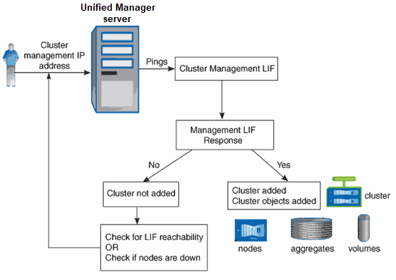

= Active IQ Unified Manager におけるクラスター検出プロセスの仕組みについて説明します。
:allow-uri-read: 
:icons: font
:imagesdir: ../media/

[role="lead"]
クラスタをUnified Managerに追加すると、サーバによってクラスタ オブジェクトが検出され、サーバのデータベースに追加されます。検出プロセスの仕組みを理解しておくと、使用するクラスタとそのオブジェクトを管理する際に役立ちます。

クラスタ構成情報を収集するための監視間隔は15分です。例えば、クラスタを追加した後、Unified Manager のUIにクラスタオブジェクトが表示されるまで15分かかります。この時間枠は、クラスタに変更を加える場合にも当てはまります。例えば、クラスタ内のSVMに2つの新しいボリュームを追加した場合、それらの新しいオブジェクトは次のポーリング間隔（最大15分）後にUIに表示されます。

次の図は検出プロセスを示しています。

新しいクラスタのオブジェクトがすべて検出されると、Unified Managerは過去15日間のパフォーマンス データの収集を開始します。これらの統計は、データの継続性収集機能を使用して収集されます。この機能では、クラスタが追加された直後から2週間分のクラスタのパフォーマンス情報を入手できます。データの継続性収集サイクルが完了すると、リアルタイムのクラスタ パフォーマンス データが収集されます（デフォルトでは5分間隔）。

[NOTE]
====
15日分のパフォーマンス データを収集するとCPUに負荷がかかるため、新しいクラスタを複数追加する場合は、データの継続性収集のポーリングが同時に多数のクラスタで実行されないように、時間差をつけて追加するようにしてください。

====