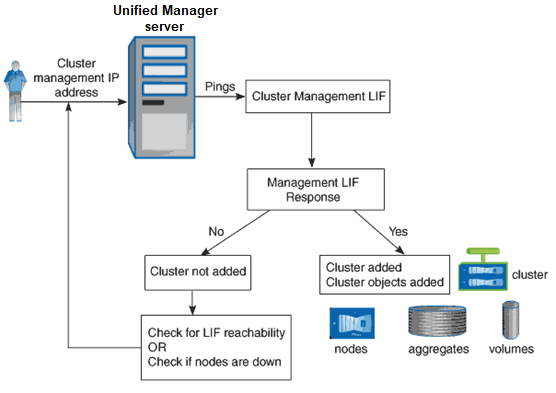

= Active IQ Unified Manager におけるクラスター検出プロセスの仕組みについて説明します。
:allow-uri-read: 
:icons: font
:imagesdir: ../media/

[role="lead"]
Unified Managerにクラスターを追加すると、サーバーはクラスターオブジェクトを検出し、それらをデータベースに追加します。検出プロセスの仕組みを理解することで、組織のクラスターとそのオブジェクトを管理しやすくなります。

デフォルトの監視間隔は 15 分です。Unified Manager サーバーにクラスターを追加した場合、Unified Manager の UI にクラスターの詳細が表示されるまで 15 分かかります。

次の図は、Active IQ Unified Managerでの検出プロセスを示しています。

