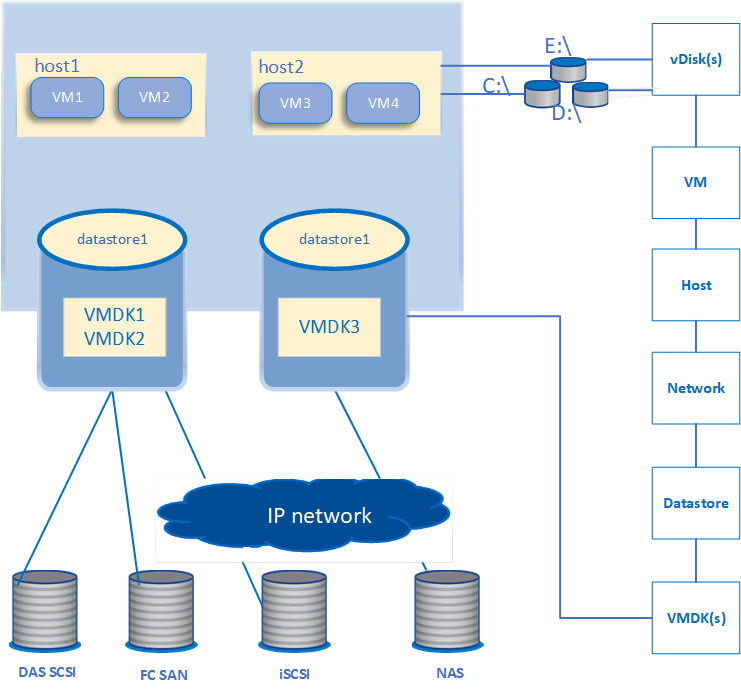
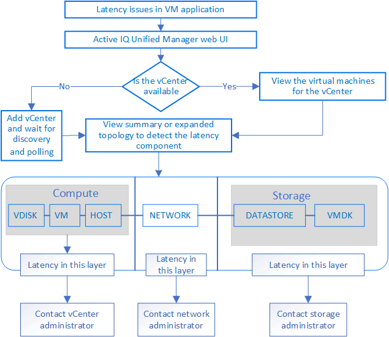

= Active IQ Unified Manager が VMware 仮想インフラを監視する方法を理解する
:allow-uri-read: 
:icons: font
:imagesdir: ../media/

[role="lead"]
Active IQ Unified Managerでは、仮想インフラ内の仮想マシン（VM）を可視化し、仮想環境内のストレージやパフォーマンスの問題を監視してトラブルシューティングできます。この機能を使用すると、ストレージ環境におけるレイテンシの問題や、vCenter Serverでパフォーマンス イベントが報告されたタイミングを特定できます。

ONTAPの一般的な仮想インフラ環境には、さまざまなコンポーネントがコンピューティング レイヤ、ネットワーク レイヤ、ストレージ レイヤに分散して配置されています。VMアプリケーションのパフォーマンスの遅延は、各レイヤのさまざまなコンポーネントが直面するレイテンシの組み合わせによって発生する可能性があります。この機能は、ストレージまたはvCenter Serverの管理者およびITゼネラリストが、仮想環境におけるパフォーマンスの問題を分析したり、問題が発生したコンポーネントを特定したりするのに役立ちます。

これで、VMwareセクションのvCenterメニューからvCenter Serverにアクセスできるようになりました。リストされている各仮想マシンのピークビューのTOPOLOGY VIEWには*VCENTER SERVER*リンクがあり、新しいブラウザでvCenter Serverを起動できます。*Expand Topology*ボタンを使用してvCenter Serverを起動し、*View in vCenter*ボタンをクリックしてvCenter Serverのデータストアを表示することもできます。

Unified Managerは、仮想環境の基盤となるサブシステムをトポロジービューで表示し、レイテンシの問題がコンピューティングノード、ネットワーク、またはストレージのいずれで発生したかを判断します。また、このビューでは、パフォーマンス低下の原因となっている特定のオブジェクトが強調表示されるため、是正措置を講じたり、根本的な問題に対処したりすることができます。

ONTAPストレージ上の仮想インフラには次のオブジェクトが含まれます。

* vCenter Server：VMware VM、ESXiホスト、および仮想環境内のすべての関連コンポーネントを管理するための、一元化されたコントロール プレーンです。vCenter Serverの詳細については、VMwareのドキュメントを参照してください。
* ホスト：ESXi（VMware の仮想化ソフトウェア）を実行し、VM をホストする物理システムまたは仮想システム。
* データストア：データストアは、ESXiホストに接続された仮想ストレージオブジェクトです。データストアは、LUNやボリュームなど、ログファイル、スクリプト、構成ファイル、仮想ディスクなどのVMファイルのリポジトリとして使用される、ONTAPの管理可能なストレージエンティティです。これらは、SANまたはIPネットワーク接続を介して環境内のホストに接続されます。vCenter ServerにマッピングされているONTAP以外のデータストアは、Unified Managerではサポートされず、表示もされません。
* VM：VMware仮想マシンです。
* 仮想ディスク：VMに属するデータストア上の仮想ディスクで、拡張子がVMDKのもの。仮想ディスクのデータは、対応するVMDKに保存されます。
* VMDK：データストア上の仮想マシンディスクであり、仮想ディスク用のストレージ領域を提供します。各仮想ディスクには、対応する VMDK が存在します。

これらのオブジェクトはVMトポロジ ビューに表示されます。

*ONTAPでのVMware仮想化*

*ユーザーワークフロー*

次の図は、VMトポロジ ビューを使用する一般的なユースケースを示しています。

[[what-is-not-supported]]
== サポートされていない機能

* vCenter ServerインスタンスにマッピングされているONTAP外部のデータストアは、Unified Managerではサポートされません。これらのデータストアに仮想ディスクがあるVMもサポートされません。
* 複数のLUNにまたがるデータストアはサポートされません。
* ネットワーク アドレス変換（NAT）を使用してデータLIF（アクセス エンドポイント）をマッピングするデータストアはサポートされません。
* 複数のLIFがある構成で、ボリュームまたはLUNを同じIPアドレスを使用して異なるクラスタ上のデータストアとしてエクスポートすることはできません。Unified Managerでは、どのデータストアがどのクラスタに属しているかを特定できないためです。
+
例：クラスタAにデータストアAがあるとします。データストアAは、同じIPアドレスx.x.x.xを使用してデータLIF経由でエクスポートされ、このデータストア上にVM Aが作成されます。同様に、クラスタBにはデータストアBがあります。データストアBは、同じIPアドレスx.x.x.xを使用してデータLIF経由でエクスポートされ、データストアB上にVM Bが作成されます。UMは、VM AのトポロジのデータストアAを対応するONTAPボリューム/LUNにマッピングすることも、VM Bをマッピングすることもできません。

* データストアとしてサポートされるのはNASボリュームとSANボリューム（VMFSの場合はiSCSIおよびFC）だけです。仮想ボリューム（vVol）はサポートされません。
* iSCSI仮想ディスクのみがサポートされます。NVMeタイプとSATAタイプの仮想ディスクはサポートされません。
* 各コンポーネントのパフォーマンスを分析するレポートは生成できません。
* Unified Manager上の仮想インフラでのみサポートされるStorage Virtual Machine（Storage VM）ディザスタ リカバリ（DR）構成の場合、スイッチオーバーとスイッチバックのシナリオでは、アクティブなLUNを参照するようにvCenter Serverで設定を手動で変更する必要があります。手動で変更しないと、データストアにアクセスできなくなります。

