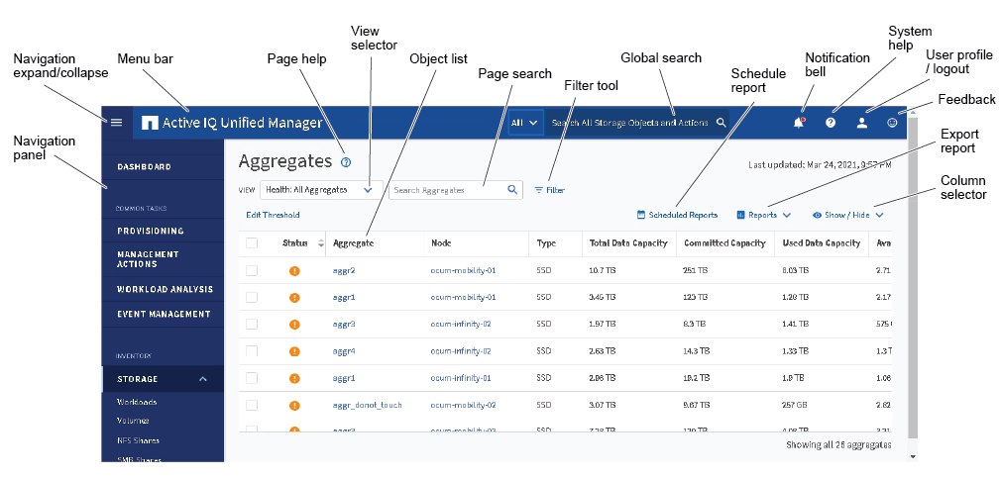
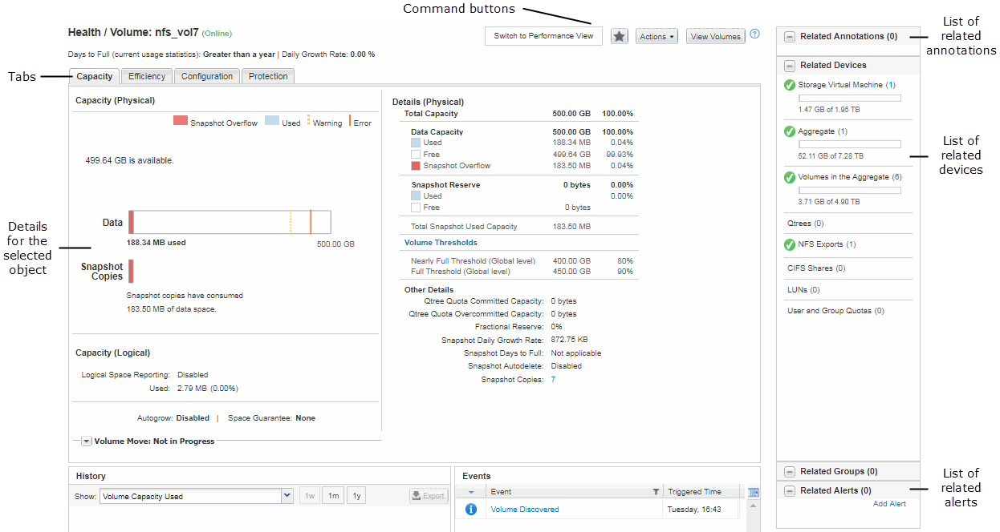

= Active IQ Unified Manager の一般的なウィンドウレイアウト
:allow-uri-read: 
:icons: font
:imagesdir: ../media/

[role="lead"]
一般的なウィンドウ レイアウトを理解しておくと、Active IQ Unified Managerを効果的に操作して使用できるようになります。Unified Manager のウィンドウのほとんどは、オブジェクト一覧表示または詳細表示という2つの一般的なレイアウトのいずれかに似ています。推奨されるディスプレイ設定は、最低でも1280×1024ピクセルです。

次の図に示すすべての要素がすべてのウィンドウに含まれているわけではありません。

[[object-list-window-layout]]
== オブジェクト リスト ウィンドウのレイアウト

[[object-details-window-layout]]
== オブジェクト詳細ウィンドウのレイアウト

