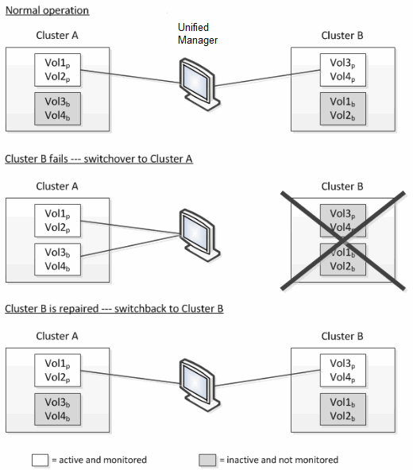
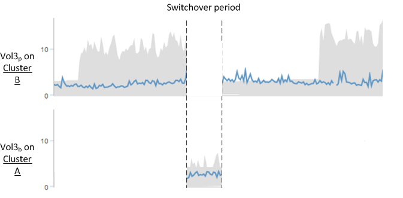

= Active IQ Unified Manager でのスイッチオーバーおよびスイッチバック時のボリュームの動作について
:allow-uri-read: 
:icons: font
:imagesdir: ../media/

[role="lead"]
スイッチオーバーまたはスイッチバックをトリガーするイベントが発生すると、ディザスタ リカバリ グループの一方のクラスタからもう一方のクラスタにアクティブなボリュームが切り替わります。クライアントにデータを提供していたアクティブなクラスタのボリュームは停止され、代わりにアクティブになったもう一方のクラスタのボリュームからデータの提供が開始されます。Unified Managerでは、実行中のアクティブなボリュームのみが監視されます。

ボリュームが一方のクラスタからもう一方のクラスタに切り替わるため、両方のクラスタを監視することを推奨します。Unified Managerでは単一のインスタンスでMetroCluster構成の両方のクラスタを監視できますが、監視する2つのクラスタ間の距離によっては、両方のクラスタを監視するためにUnified Managerインスタンスが2つ必要になる場合もあります。次の図は、Unified Managerの単一のインスタンスを示しています。

名前に「p」が付いているボリュームはプライマリ ボリュームで、「b」が付いているボリュームはSnapMirrorで作成されたバックアップ用のミラー ボリュームです。

通常運用時の状態は次のとおりです。

* クラスターAには、Vol1pとVol2pという2つのアクティブなボリュームがあります。
* クラスターBには、Vol3pとVol4pという2つのアクティブなボリュームがあります。
* クラスターAには、Vol3bとVol4bという2つの非アクティブなボリュームがあります。
* クラスターBには、Vol1bとVol2bという2つの非アクティブなボリュームがあります。

Unified Managerにより、アクティブなボリュームのそれぞれに関する情報（統計やイベントなど）が収集されます。Vol1pとVol2pの統計がクラスタAから収集され、Vol3pとVol4pの統計がクラスタBから収集されます。

重大な障害が発生してアクティブなボリュームがクラスタBからクラスタAにスイッチオーバーされると次のようになります。

* クラスターAには、Vol1p、Vol2p、Vol3b、Vol4bの4つのアクティブなボリュームがあります。
* クラスターBには、Vol3p、Vol4p、Vol1b、Vol2bの4つの非アクティブなボリュームがあります。

通常運用時と同様に、Unified Managerでアクティブなボリュームのそれぞれに関する情報が収集されます。ただし、この場合は、Vol1pとVol2pの統計がクラスタAから収集され、Vol3pとVol4pの統計もクラスタAから収集されます。

Vol3pとVol3bは異なるクラスタにあり、同じボリュームではないことに注意してください。Unified Managerに表示されるVol3pの情報は、Vol3bと同じにはなりません。

* クラスタAにスイッチオーバーしている間は、Vol3pの統計とイベントは表示されません。
* スイッチオーバーの発生直後は、履歴情報がないため、Vol3bは新規のボリュームのように見えます。

クラスタBが復旧してスイッチバックが実行されると、クラスタBのVol3pが再びアクティブになり、スイッチオーバーしていた期間を除いた状態で過去の統計が表示されます。クラスタAのVol3bの情報は、次にスイッチオーバーが発生するまでは表示されません。

[NOTE]
====
* MetroClusterスイッチバック後にクラスターA上のVol3bのように非アクティブになったボリュームは、「`このボリュームは削除されました`」というメッセージで識別されます。ボリューム自体は削除されていませんが、アクティブなボリュームではないため、現在はUnified Managerによる監視対象になっていません。
* 単一の Unified Manager が MetroCluster 構成の両方のクラスターを監視している場合、ボリューム検索はその時点でアクティブなボリュームの情報を返します。たとえば、スイッチオーバーが発生してクラスタAでVol3がアクティブになっている場合、「Vol3」を検索するとクラスタAのVol3bの統計とイベントが返されます。

====