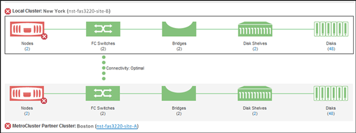

= Active IQ Unified Manager での MetroCluster 構成の監視
:allow-uri-read: 
:icons: font
:imagesdir: ../media/

[role="lead"]
MetroCluster構成の接続の問題を監視することができます。クラスタ内のコンポーネントおよび接続のステータス、MetroCluster構成のクラスタ間の接続ステータスなどの詳細情報を確認できます。ここでは、MetroCluster over FC構成とMetroCluster over IP構成で保護されているクラスタの接続の問題を監視する方法について説明します。

MetroCluster構成は、Active IQ Unified Managerの左側のナビゲーション ペインから表示する次のビューで監視できます。

* *ストレージ* > *クラスタ* > *保護：MetroCluster*ビュー
* *保護* > *関係* > *関係：MetroCluster* ビュー

Unified Managerでは、システム健全性アラートを使用して、MetroCluster構成のコンポーネントおよび接続のステータスを示します。

.開始する前に
* MetroCluster構成のローカル クラスタとリモート クラスタの両方を、Active IQ Unified Managerに追加する必要があります。
* MetroCluster over IP構成では、Mediatorがサポートされる場合は、対応するAPIでMediatorを設定してクラスタに追加する必要があります。
* オペレータ、アプリケーション管理者、またはストレージ管理者のロールが必要です。

[[monitor-connectivity-issues-in-metrocluster-over-fc-configuration]]
== MetroCluster over FC構成の接続の問題の監視

MetroCluster over FC構成のクラスタの場合、接続チャートは*Cluster / Health*詳細ページに表示されます。以下の手順に従ってください。

.手順
. 左側のナビゲーションペインで、*ストレージ* > *クラスター* をクリックします。
+
監視対象であるすべてのクラスタのリストが表示されます。

. *保護：MetroCluster*ビューから、FC構成のMetroClusterの詳細を表示するクラスタの名前をクリックします。または、MetroCluster構成のクラスタでフィルタリングすることもできます。
. *クラスター / ヘルス*詳細ページで、*MetroCluster接続*タブをクリックします。*MetroCluster接続*タブは、FC経由のMetroCluster構成でのみ使用できます。
+

+
対応するクラスタ オブジェクト領域にMetroCluster構成のトポロジが表示されます。[クラスタ / 健全性の詳細]ページに表示される情報を基に、接続の問題を修正できます。たとえば、クラスタ内のノードとスイッチの間の接続がダウンしている場合は、次のアイコンが表示されます。

アイコンにカーソルを合わせると、生成されたイベントに関する詳細情報が表示されます。

MetroCluster構成で接続の問題が見つかった場合は、System ManagerにログインするかONTAP CLIにアクセスして問題を解決する必要があります。

クラスタの状態を判断する方法の詳細については、link:../health-checker/task_check_health_of_clusters_in_metrocluster_configuration.html#determine-cluster-health-in-metrocluster-over-fc-configuration["FC構成のMetroClusterにおけるクラスタの健全性の確認"]を参照してください。

[[monitor-connectivity-issues-in-metrocluster-over-ip-configuration]]
== MetroCluster over IP構成の接続の問題の監視

IP構成のMetroClusterのクラスターの場合、接続チャートは*Clusters*ページに表示されます。以下の手順に従ってください。

.手順
. 左側のナビゲーションペインで、*ストレージ* > *クラスター* をクリックします。
+
監視対象であるすべてのクラスタのリストが表示されます。

. *保護：MetroClusters*ビューから、IP経由のMetroCluster構成の詳細を表示するクラスタの名前をクリックします。または、MetroCluster構成のクラスタでフィルタリングすることもできます。
. キャレット `v`アイコンをクリックして行を展開します。キャレットアイコンは、MetroCluster over IP構成によって保護されているクラスタに対してのみ表示されます。
+
ソース サイトとミラー サイトのトポロジ、および接続に使用されていればMediatorを表示できます。表示できる情報は次のとおりです。

+
** サイト間の接続
** 両方のサイトの健全性と可用性の問題（ある場合）
** Mediator関連の問題
** レプリケーション関連の問題
+

NOTE: 以下のステータスが報告されます：重大（image:sev_critical_um60.png[""]）、エラー（image:sev_error_um60.png[""]）、または正常（image:sev_normal_um60.png[""]）。同じトポロジ内のプライマリデータとミラーデータのアグリゲートデータレプリケーションステータスを表示することもできます。

+
次の図では、ソース クラスタとデスティネーション クラスタ間にサイト間接続がなく、クラスタ間にMediatorが設定されていないことがわかります。

+
image:mcc-ip-conn-status.png["ソースサイトとミラーサイト、およびMediatorのトポロジを示すUIスクリーンショット。"]

. ステータスアイコンをクリックします。エラー定義を含むメッセージが表示されます。お客様のMetroCluster IP構成で問題に対するイベントが発生している場合、メッセージの*View Event*ボタンをクリックしてイベントの詳細を表示できます。問題とイベントを解決すると、このトポロジのステータスアイコンは通常（image:sev_normal_um60.png[""]）になります。
. 詳細な設定情報は、*クラスター / ヘルス*詳細ページの*構成*タブにある*MetroCluster 概要*および*保護*セクションで確認できます。

NOTE: MetroCluster IP構成の場合のみ、*クラスター*ページでクラスタトポロジを表示できます。MetroCluster FC構成のクラスタの場合、トポロジは*クラスター / ヘルス*詳細ページの*MetroCluster 接続*タブに表示されます。

*関連情報*

* link:../health-checker/reference_health_cluster_details_page.html["[クラスタ / 健全性の詳細]ページ"]
* *Relationship：MetroCluster* ビューの詳細については、link:../storage-mgmt/task_monitor_metrocluster_configurations.html["MetroCluster構成の監視"]を参照してください。
* 「関係性：過去1か月間の転送状況」の表示に関する情報については、link:../data-protection/reference_relationship_last_1_month_transfer_status_view.html["関係：過去 1 ヶ月の転送ステータス表示"]を参照してください。
* 「関係：過去1か月の転送レート」ビューに関する情報については、link:../data-protection/reference_relationship_last_1_month_transfer_rate_view.html["関係：過去1か月間の転送速度ビュー"] を参照してください。
* 「関係：すべての関係」ビューの詳細については、link:../data-protection/reference_relationship_all_relationships_view.html["関係：すべての関係を表示"]を参照してください。

