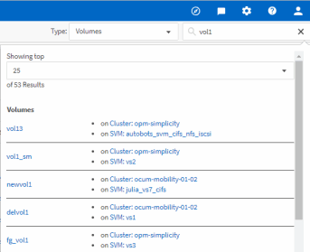

= Active IQ Unified Manager でストレージオブジェクトを検索する
:allow-uri-read: 
:icons: font
:imagesdir: ../media/

[role="lead"]
特定のオブジェクトにすばやくアクセスするには、メニューバー上部の「すべてのストレージオブジェクトを検索」フィールドを使用できます。この、すべてのオブジェクトを対象としたグローバル検索方法により、種類別に特定のオブジェクトをすばやく見つけることができます。検索結果はストレージオブジェクトの種類ごとに並べ替えられ、ドロップダウンメニューを使用してオブジェクトごとにさらに絞り込むことができます。

.開始する前に
* このタスクを実行するには、オペレーター、アプリケーション管理者、またはストレージ管理者のいずれかの役割が必要です。
* 検索キーワードは3文字以上入力する必要があります。

ドロップダウン メニューで[すべて]を選択すると、グローバル検索によってすべてのオブジェクト カテゴリで見つかった結果の総数が表示されます（オブジェクト カテゴリごとに最大25件）。ドロップダウン メニューで特定のオブジェクト タイプを選択すると、検索の対象をそのオブジェクト タイプに絞り込むことができます。この場合、結果のリストに表示されるオブジェクトの数は上位25個に限定されません。

検索対象として選択できるオブジェクト タイプは次のとおりです。

* クラスタ
* ノード
* Storage VM
* アグリゲート
* ボリューム
* qtree
* SMB共有
* NFS共有
* ユーザ / グループ クォータ
* LUN
* NVMe ネームスペース
* イニシエータ グループ
* Initiators
* 整合性グループ

ワークロード名を入力すると、該当する[ボリューム]または[LUN]カテゴリの下にワークロードの一覧が表示されます。

検索結果でいずれかのオブジェクトをクリックすると、そのオブジェクトの[健全性の詳細]ページが表示されます。オブジェクトに直接対応する[健全性]ページがない場合は、親オブジェクトの[健全性]ページが表示されます。たとえば、特定のLUNを検索する場合は、そのLUNが配置されているSVMの詳細ページが表示されます。

[NOTE]
====
ポートとLIFはグローバル検索バーでは検索できません。

====
.手順
. メニューでオブジェクト タイプを選択して、検索結果を特定のオブジェクト タイプに絞り込みます。
. 「すべてのストレージオブジェクトを検索」フィールドに、オブジェクト名の3文字以上を入力します。
+
この例では、ドロップダウンボックスで「ボリューム」オブジェクトタイプが選択されています。「すべてのストレージオブジェクトを検索」フィールドに「vol1」と入力すると、名前にこの文字が含まれるすべてのボリュームのリストが表示されます。

+

